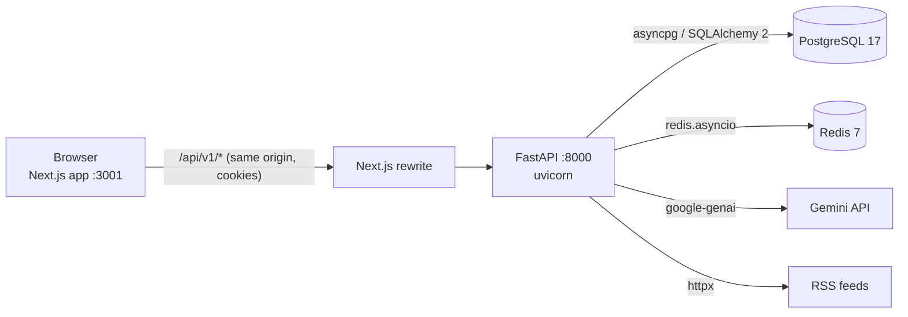
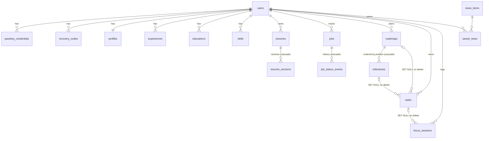

# Mandy API — architecture

## System



- **Auth**: single owner, WebAuthn passkeys (py_webauthn). Challenges live in Redis for 5 minutes and are deleted on
  first use. Sessions are JWTs in httpOnly cookies (`access_token` 15 min, `refresh_token` 7 days, rotated on refresh,
  used tokens are revoked in Redis) plus the non-secret `mandy_session=1` hint cookie for the Next.js proxy.
  Recovery codes are stored as Argon2id hashes only.
- **Redis** is used for: WebAuthn challenges, rate limiting (fixed window per IP and endpoint), refresh-token
  revocation, the per-user dashboard cache (60 s, invalidated by bumping a per-user version key on writes) and the
  shared news page cache (5 min, `is_saved` merged per user after the cache). Cache failures degrade to DB reads.
- **Gemini** is reached only through `app/core/ai.py::AIClient` (`generate_text`, `generate_structured`,
  `chat_with_tools`). No key → 503 `AI_UNAVAILABLE`; quota → 429 `AI_RATE_LIMITED`; other errors → 502 `AI_ERROR`.
- **News** comes from a `NewsProvider` protocol; `RSSProvider` fetches feeds concurrently and skips any feed that
  fails, so `POST /news/refresh` never errors because a source is down.

## Code layout

```
app/
  main.py            app factory: middleware, exception handlers, routers under /api/v1
  core/              config, logging, exceptions, security (JWT/argon2), redis+cache, rate limit, middleware, ai
  db/                Declarative base (naming convention), UUID + timestamp mixins, async session, model registry
  shared/            pagination (Page[T]), ownership helper, timezone helpers, common schema types
  features/<name>/   router.py (thin) · schemas.py (Pydantic) · service.py (logic + queries) · models.py (ORM)
  scripts/seed.py    demo data
alembic/             async migrations (0001 auth … 0006 focus/news)
tests/               pytest + httpx ASGI client, rolled-back transaction per test
```

Requests flow: middleware (request id + access log → security headers → body-size limit → CORS) → router →
`get_current_user` dependency → service → SQLAlchemy. Every query is filtered by `user_id`; other users' records are 404.

## Data model



All tables have a UUID primary key and `created_at`/`updated_at` (timezone-aware, UTC). Enums are stored as
`VARCHAR` + `CHECK` constraints (no native PG enum types, so migrations stay simple). JSONB holds flexible
structures (`profiles.links/preferences`, `resumes.content` validated by Pydantic, `milestones.resources`).

Indexes worth knowing: `jobs(user_id, status)`, `jobs(user_id, updated_at)`, `tasks(user_id, status, due_date)`,
`tasks(user_id, completed_at)`, `focus_sessions(user_id, started_at)`, `news_items(published_at)`,
unique `news_items(url)`, unique `saved_news(user_id, news_item_id)`, unique `resume_versions(resume_id, version)`.

## Security notes

- Security headers on every response (nosniff, frame deny, referrer policy, COOP, strict CSP for API responses, HSTS in
  prod); request bodies over 1 MiB → 413.
- No SQL string building: all queries are SQLAlchemy expressions; `ILIKE` input is escaped.
- `JWT_SECRET` must be ≥ 32 chars and not the dev default when `ENV=prod`; `DEV_LOGIN_ENABLED` is rejected in prod and
  the dev-login route is only registered when `ENV=dev`.
- Logs never include bodies, cookies or tokens; 500s return a generic message and log the stack with the request id.

## Deployment

`Dockerfile` builds a slim, non-root image; `docker/entrypoint.sh` runs `alembic upgrade head` and then uvicorn.
Required env in production: `ENV=prod`, `DATABASE_URL`, `REDIS_URL`, `JWT_SECRET`, `CORS_ORIGINS`, `RP_ID`, `ORIGIN`
(and optionally `GEMINI_API_KEY`). Any container host with managed Postgres + Redis works (Railway, Render, Fly.io).
